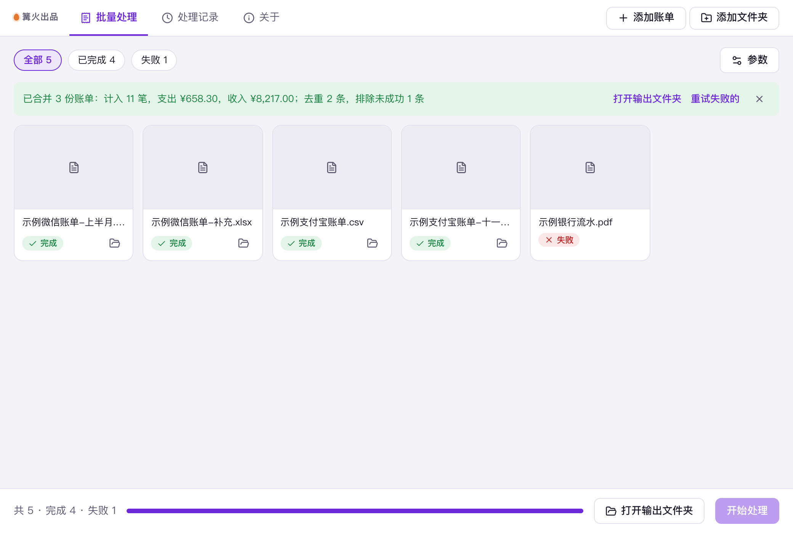

# 微信 / 支付宝账单对账

> 篝火出品 · 收录于篝火 App 应用区

多份账单合并、分类、汇总



## 下载

到 [Releases](https://github.com/campfire-code/bill-reconciler/releases/latest) 下载对应安装包：

| 电脑 | 文件 |
|---|---|
| Windows 10 / 11 | `bill-reconciler_版本号_windows-x64-setup.exe` |
| Mac（Apple 芯片） | `bill-reconciler_版本号_mac-arm64.dmg` |
| Mac（Intel 芯片） | `bill-reconciler_版本号_mac-x64.dmg` |

第一次打开：
- **Windows**：如果弹出「Windows 已保护你的电脑」，点「更多信息」→「仍要运行」。
- **Mac**：如果提示「无法验证开发者」，打开「系统设置 → 隐私与安全性」，在下方点「仍要打开」。

## 怎么用

1. 先在微信、支付宝 App 里导出账单文件（.csv 或 .xlsx）。导出入口和格式以 App 当前版本为准，本工具未对照最新版本核实。
2. 把一份或多份账单拖进窗口（微信、支付宝可以混着放，也可以放同一平台不同时间段的多份）。
3. 在「参数」里按需调整：是否去掉重复记录、是否排除未成功的交易、自定义分类规则，并选好保存位置。
4. 点「开始处理」，得到一个 Excel（默认 `账单对账结果.xlsx`），包含：总览、按分类、按月份、按对方（支出前 20）、明细，以及（有的话）「已排除（未成功）」。

规则说明：
- **去重**：按「来源 + 订单号 + 收支 + 金额」判断同一笔，保留先读到的一条。没有订单号的记录按时间、金额、对方、商品判断。
- **未成功交易**：状态含「关闭」「失败」「已撤销」「未支付」的记录不计入汇总。
- **不计收支**：收/支列为「/」或「不计收支」的记录（如零钱提现、信用卡还款）列在明细里，不计入收入、支出金额。
- **退款**：不做自动冲销。微信、支付宝通常会把退款记成一笔收入，与原支出相抵；原支出那行的状态会显示「已退款」之类。
- **分类**：按关键词匹配「交易对方、商品、交易类型」，先匹配你写的规则，再匹配内置规则，都没命中归「其他」。内置关键词只是常见词的粗略匹配，建议按自己的消费习惯补充规则。
- 金额按「分」做整数计算，不会出现小数误差。

已知限制：只认微信、支付宝导出的 .csv / .xlsx，表头需保持原样；两个平台之间的互相转账不做配对；不对接银行流水；账单版式依据常见导出样例编写，微信、支付宝以后改版可能需要更新（没有用真实账单验证过，使用前请用自己的一份账单核对总额）。

## 验收用例

用 `samples/` 里的三份虚构账单：

1. 只拖入 `示例微信账单-上半月.csv`，点「开始处理」。列表里应显示「微信账单 7 笔，支出 ¥379.50，收入 ¥217.00」。
2. 三份一起拖入（`示例微信账单-补充.xlsx` 里有 2 笔与上半月重复，`示例支付宝账单.csv` 是 GBK 编码且有 1 笔「交易关闭」）。处理完应提示：计入 11 笔，支出 ¥658.30，收入 ¥8,217.00；去重 2 条，排除未成功 1 条。
3. 打开 `账单对账结果.xlsx`：「明细」共 12 行数据按时间排序，「已排除（未成功）」里有 1 行「收纳盒」，「总览」里不计收支笔数为 1（零钱提现）。
4. 关掉「去掉重复记录」重新处理，提示应变为「去重 0 条」。
5. 在「自定义分类规则」里写 `示例咖啡店=提神`，重新处理，明细里「拿铁咖啡」那行的分类应为「提神」。
6. 拖入任意一个不是账单的 .csv，应显示失败并提示「没有找到账单表头」。

## 自己编译

需要 Node.js 22、pnpm、Rust。

```bash
pnpm install
pnpm test          # 单元测试
pnpm tauri dev     # 开发运行
pnpm tauri build   # 打包
```

界面框架在 `src/kit`（所有 campfire-code 工具共用），本工具的逻辑在 `src/tool`。

## 归属

本工具由**篝火**出品，是篝火 App 应用区收录的开源工具之一，由篝火（GitHub 组织 [campfire-code](https://github.com/campfire-code)）维护与更新。全部工具的目录见 [toolkit-hub](https://github.com/campfire-code/toolkit-hub)。

## 许可证

MIT，版权方为篝火（campfire-code）。
